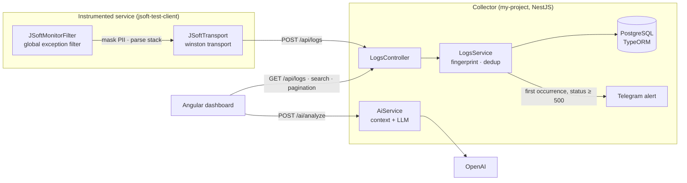

# JSoft Monitor: Centralized Error Monitoring

> A self-hosted error-aggregation platform: a drop-in NestJS exception filter ships structured, PII-masked error events to a central collector that fingerprints and deduplicates them, persists them in PostgreSQL, alerts on critical failures via Telegram, and offers LLM-assisted root-cause analysis from an Angular dashboard.


---

## Architecture Overview

The system follows a classic **collector / agent / console** topology. Instrumented services never talk to the database directly: they emit events over HTTP, and the collector owns persistence, deduplication and alerting.



**Event pipeline:**
1. `JSoftMonitorFilter` (`@Catch()`) intercepts every unhandled exception, extracts status, endpoint, method, IP, user agent, stack trace, failing file/function (parsed from the stack), and a **recursively masked** request payload.
2. A custom `winston` transport (`JSoftTransport`) forwards the event to the collector; delivery failures are caught and logged so monitoring can never break the host service's request path.
3. The collector computes an **MD5 fingerprint** of `projectKey + fileLocation + errorMessage`. A repeated error increments an `occurrences` counter on the existing row instead of inserting a new one.
4. Only a *new* error with `statusCode >= 500` triggers a Telegram alert, which avoids alert storms from a repeating fault.

---

## Key Features

- **Fingerprint-based error grouping.** Identical failures collapse into one record with an occurrence counter and the latest payload/IP, which keeps the table small and the signal high.
- **Privacy by design on the client.** Request bodies are masked recursively for keys such as `password`, `token`, `secret`, `credit_card`, `cvv` and `auth` *before* anything leaves the service.
- **Query layer built for triage.** Server-side pagination with total counts, case-insensitive multi-column search (`ILIKE` over project, endpoint, message and timestamp), date-range filtering, `jsonb` payload storage, and bulk delete, all implemented with the TypeORM query builder and bound parameters.
- **LLM-assisted root-cause analysis.** `AiService` reads a window of source lines around the failing location (with a **path-traversal guard** that rejects files outside the project root) and asks the model for analysis, severity and a proposed fix. Without an API key it returns a harmless placeholder; API failures are returned as readable errors instead of crashing.
- **Resilient startup.** TypeORM connects with `retryAttempts: 10` and a 3-second delay, so the collector tolerates the database coming up slowly under Docker Compose.
- **Self-documenting API.** Swagger UI at `/api`, with CORS restricted to the dashboard and test client origins.
- **Optional Sentry forwarding.** The client filter also reports to Sentry when `SENTRY_DSN` is set.

---

## Tech Stack & Rationale

| Technology | Why it was chosen |
| :-- | :-- |
| **NestJS (TypeScript)** | Modular DI architecture and first-class exception filters, which map naturally onto an instrumentation agent and a collector. |
| **PostgreSQL + TypeORM** | Relational integrity plus `jsonb` for flexible payloads, with a typed entity model and a query builder for safe dynamic filtering. |
| **Angular** | Component-based console for browsing logs, filtering and inspecting error details. |
| **winston + nest-winston** | Pluggable transports: the monitoring hook is a standard logging transport, not a bespoke integration. |
| **OpenAI (`gpt-4o-mini`)** | Cost-efficient model for stack-trace explanation and fix suggestions. |
| **Telegram Bot API** | Zero-infrastructure, real-time incident notification. |
| **Docker Compose** | One command brings up PostgreSQL, Redis, the collector, the dashboard and a demo client. |
| **Swagger/OpenAPI** | Living API documentation generated from the code. |

---

## Repository Layout

```text
├── my-project/          # Central collector: logs + ai modules, TypeORM entity
├── jsoft-dashboard/     # Angular monitoring UI
├── jsoft-test-client/   # Demo NestJS service wired with the filter + transport
└── docker-compose.yml   # db, redis, backend, frontend, test-client
```

---

## Getting Started

```bash
git clone https://github.com/NURJAKS/centralized-logging-system.git
cd centralized-logging-system

cat > .env <<'EOF'
TG_BOT_TOKEN=your_telegram_bot_token
TG_CHAT_ID=your_chat_id
OPENAI_API_KEY=your_openai_key
EOF

docker compose up --build
```

| Service | URL |
| :-- | :-- |
| Dashboard | http://localhost:4200 |
| Collector API / Swagger | http://localhost:3005 · `/api` |
| Demo client | http://localhost:3001 (`POST /checkout`, `POST /crash-test` raise sample errors) |

### Main endpoints

| Method | Path | Purpose |
| :-- | :-- | :-- |
| `POST` | `/api/logs` | Ingest an error event |
| `GET` | `/api/logs?page&limit&search&startDate&endDate` | Paginated, filterable list |
| `POST` | `/api/logs/delete` | Bulk delete by IDs |
| `POST` | `/ai/analyze` | AI analysis of a selected error |

---

## Known Limitations & Roadmap

Documented honestly so the next steps are explicit:

- Replace `synchronize: true` with TypeORM migrations, and read database credentials from the environment (currently hard-coded in the module and the Compose file).
- Add DTOs with `class-validator` (already a dependency) to the ingestion endpoint, and API-key authentication per `projectKey`.
- Add an index on `error_hash` to speed up the deduplication lookup, and make the upsert atomic (unique constraint plus `ON CONFLICT`) so concurrent identical events cannot race.
- Escape user-controlled text in Telegram Markdown messages.
- Redis is provisioned in Compose but not used yet; planned for ingestion buffering / rate limiting.
- Expand automated tests (only a scaffold e2e test exists today).
